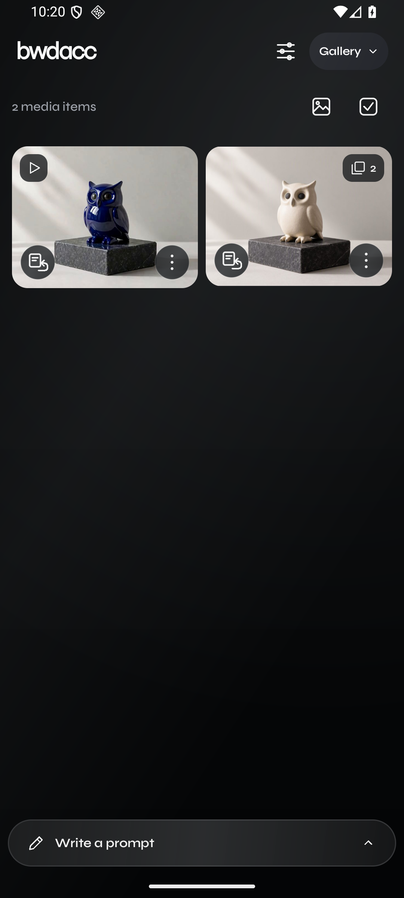
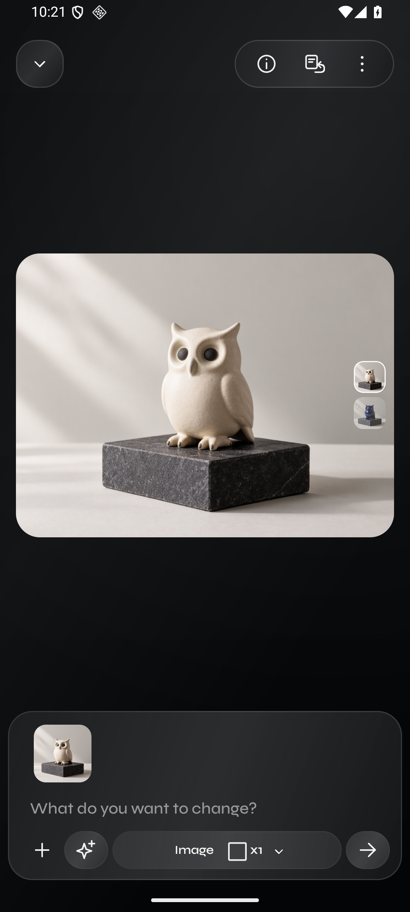
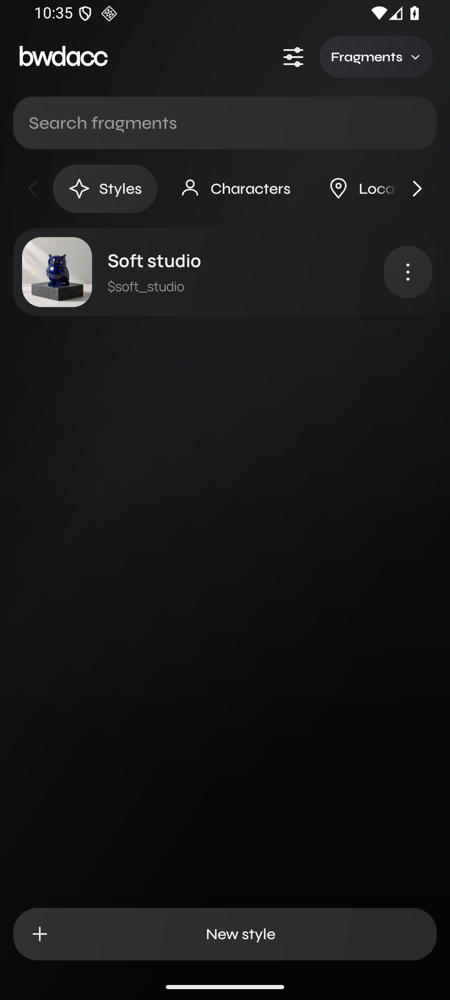
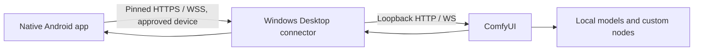

# bwdacc

**Your ComfyUI studio, designed for your phone.**

bwdacc is a native Android app for creating, editing and organizing images and
videos with ComfyUI running on your Windows PC. A compact prompt composer,
touch-first controls and swipeable versions keep the creative work on the phone;
your computer runs the models.

**Development preview:** Android 0.11.7-dev / Desktop 0.7.0. This is working
prototype source, not a production or independently security-audited release.

[Watch the 107-second demo](docs/demo/bwdacc-mobile-demo.mp4) ·
[Build and connect](docs/SETUP.md) · [Workflow catalog](WORKFLOWS.md) ·
[License](LICENSE)

  
  
  

## A mobile creative workflow

- Generate images or videos, choose a workflow and aspect ratio, and send up to
  four variations. Supported workflows expose resolution, seed, steps, negative
  prompt, LoRAs and other generation controls.
- Edit from any image version. Swipe vertically through versions and horizontally
  between sets; the selected version becomes the set's cover. Reuse a generation
  with its prompt, references and settings.
- Animate an image, use first/last frames, edit a clip, trim before extending it,
  upscale, or apply local MuseTalk lipsync when the required resources are installed.
- Reuse **Fragments**: characters, styles, places, objects, audio and compositions.
  Import media, record audio, extract composition boxes, select an object with
  EfficientSAM3, and generate depth/pose/lineart maps.
- Keep experiments in **Prompter**, with a persistent prompt and 24-hour cleanup
  of unsaved results. Like a result to keep it; organize saved work in **Projects**.
- Browse a gallery that preserves aspect ratios, play visible videos muted, and
  manage versions, deletion and exports from the phone.

Compatibility depends on the selected workflow. Control maps can be extracted
and stored today; using them as generation conditioning is still pending.

## Run it

You need an Android 8+ device, Windows x64, and a compatible ComfyUI GPU setup.
The managed installer currently targets NVIDIA GPUs with at least 8 GB VRAM,
compute capability 7.5+, and driver 580+. Individual workflows may need 16 or
24+ GB. Model weights are **not** included in this repository or the APK.

1. Clone this repository and follow [the build instructions](docs/SETUP.md).
2. Open bwdacc Desktop. Choose a separate managed ComfyUI installation, or connect
   your already running local installation.
3. Pair the Android app using Desktop's temporary QR/code and approve the device.
4. Choose a workflow whose nodes and models are installed, then generate.

Same-network use does not require a VPN. Remote access uses your own Tailscale
network; no bwdacc public relay or hosted cloud service is required or included.

## How it is built

The Android client is Java with custom native UI, a persistent generation queue,
recipe-based reuse and an encrypted local media vault. The Windows app is WPF
on .NET 10. It manages pairing, scoped access, model downloads and an optional
isolated Python runtime. Python custom nodes provide media operations and
reference extraction. Bundled API graphs and dependency manifests select model
families and memory profiles without moving a node canvas onto a small screen.

| Path | Contents |
|---|---|
| `app/src/main` | Android UI, generation logic, resources and translations |
| `app/src/main/assets/workflows` | API graphs, VRAM profiles and dependency catalogs |
| `desktop` | Windows manager, authenticated gateway and runtime installer |
| `server` | bwdacc custom nodes and optional MuseTalk installer |
| `tests` | Java, Python, emulator and Desktop checks |
| `tools` | Catalog builders and explicit maintenance utilities |
| `docs/demo` | English narrated demo, captions and generated showcase media |

## Workflows and models

The catalog includes MOSS, Kromoss, Ideogram 4, Krea 2, FLUX.2 Klein edits,
MiniMax H3 normal/Turbo and specialized image/video operations. Memory profiles
are selectable; unsupported combinations are unavailable. A listed workflow is
not a guarantee that its models are installed or that every resolution will fit.

See [WORKFLOWS.md](WORKFLOWS.md), the [machine-readable catalog](app/src/main/assets/workflows/catalog.json)
and [media operations](app/src/main/assets/workflows/media-operations.json) for
sources, pinned revisions, hashes, model destinations and node requirements.
These JSON files use ComfyUI **API format**, not its visual canvas format.

Models and downloaded runtimes retain their own licenses. In particular, MiniMax
H3 has separate community/geographic/commercial conditions. An open-source app
license does not grant model redistribution or hosted-service rights; check the
upstream terms linked in [THIRD_PARTY_NOTICES.md](THIRD_PARTY_NOTICES.md).

## Privacy and current limits

Pairing uses Desktop approval, certificate pinning and revocable device credentials.
Local app media is encrypted through Android Keystore-backed vault storage.
ComfyUI and custom nodes can still retain **unencrypted inputs, outputs and caches
on the PC**. The app's covers and visibility controls are not server-side deletion
or encryption. See [CONNECTION.md](CONNECTION.md), [VAULT.md](VAULT.md),
[BACKUP.md](BACKUP.md) and [TAILSCALE.md](TAILSCALE.md).

Generation runs on the connected machine. Optional prompt-agent endpoints and
third-party nodes have their own data handling. Use trusted nodes and keep the
ComfyUI listener private. The project does not include subscriptions, a managed
cloud service, biometric unlocking or automatic cleanup of server media.

The source retains the same optional private-mode and cover behavior as the
development app. It is not a separate restricted contest edition. The public
snapshot excludes personal media, pairing credentials, signing keys, local
inventory and private development history. Unknown LoRAs retain the existing
conservative classification behavior.

## Demo and validation

The [demo](docs/demo/README.md) shows real compiled Android UI with a synthetic
showcase library. Its owl image, image edit and animation were generated locally
using MOSS, Klein and MiniMax H3. Model execution and UI recording are separate
captures, not one continuous recording of submission through completion.

The project has been exercised on an RTX 3090 (24 GB), an Android emulator and a
physical Android phone. This does not establish performance on every VRAM tier.
See [docs/VALIDATION.md](docs/VALIDATION.md) for the publication checks and limits.

The Open Source Higgsfield entry requires public source, workflows, an open-source
license and setup instructions; see the [official competition page](https://comfy.org/open-source-higgsfield).
Publishing this repository does not itself submit the competition form.

## License and credits

Original bwdacc code, documentation and workflow adaptations are licensed under
**Apache-2.0**. Third-party libraries, fonts and upstream workflow notices remain
under their respective licenses. See [LICENSE](LICENSE), [NOTICE](NOTICE) and
[THIRD_PARTY_NOTICES.md](THIRD_PARTY_NOTICES.md).

Built on the work of ComfyUI, model authors and the custom-node community.
